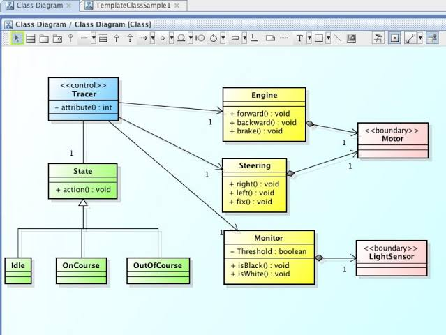
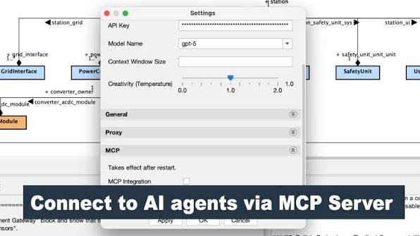

# Astah for Visual UML Modeling and Software Design

Astah is a desktop modeling tool family for describing software structure, behavior, and system designs.
Astah UML focuses on UML modeling, while Astah Professional adds diagram types and tools for broader design work.

[](https://github.com/mertiege7838/astah-uml/releases/)

## Table of Contents

- [Background](#background)
- [Editions and Modeling Scope](#editions-and-modeling-scope)
- [Working with Models](#working-with-models)
- [Source Code and Class Diagrams](#source-code-and-class-diagrams)
- [Diagram Export](#diagram-export)
- [Team Reviews](#team-reviews)
- [AI and Extensions](#ai-and-extensions)
- [Desktop Compatibility](#desktop-compatibility)
- [Boundaries and Licensing](#boundaries-and-licensing)

## Background

Astah software helps turn a design discussion into diagrams that can be reviewed and revised.
Use structural views to describe the parts of a system and behavioral views to explain how those parts interact.

A class diagram can define responsibilities and relationships.
A sequence diagram can show the messages exchanged during one scenario.

Keep each view focused on a question that matters to its audience.
A compact diagram with clear names is often easier to review than a single canvas containing every detail.

## Editions and Modeling Scope

| Product | Main purpose | Scope to check before use |
| --- | --- | --- |
| Astah UML | UML diagrams and mind maps | Suitable diagram types and integration requirements |
| Astah Professional | UML plus ERD, DFD, flowcharts, and other design views | Professional features required by the project |
| Astah SysML | Systems modeling and MBSE | SysML workflow and its separate release requirements |
| Astah System Safety | Safety-oriented modeling and analysis | Required safety notations and methods |
| Astah Viewer | Viewing Professional and UML projects | Viewing rather than full model editing |

Astah Professional and Astah UML currently share the 12.0 release.
Astah SysML follows its own release sequence; the product names are not interchangeable editions of one feature set.

Astah Community was discontinued on September 26, 2018.
It should not be treated as a current free edition of Astah UML.



## Working with Models

Organize related model elements into packages so the project remains navigable.
Give classes, operations, and relationships names that communicate their purpose.

Useful modeling habits include:

- State the scenario or design question before adding diagram elements.
- Reuse the intended model element when it appears in several views.
- Distinguish a new model element from another presentation of an existing one.
- Keep relationship direction and multiplicity deliberate.
- Separate broad architecture views from detailed interactions.

Use class diagrams for responsibilities, interfaces, and associations.
Use sequence diagrams to examine the order of messages in a selected interaction.

Activity diagrams can describe a workflow and its decisions.
State machines can describe changes in the state of a modeled object.

Diagram layout should support the meaning of the model.
After automatic layout, review labels and relationship paths before sharing the result.

## Source Code and Class Diagrams

Astah UML and Professional can import Java source code into model elements.
From the imported package or class, a class diagram can be created automatically.

The following small Java class is an original example for a source import exercise.
Save it as `ReviewItem.java` and select it through Tools > Java > Import Java.

```java
public class ReviewItem {
    private String title;
    public String getTitle() {
        return title;
    }
}
```

Choose Java as the project language when working with Java-specific model properties.
Check the imported attribute and operation before expanding the example into a larger model.

- Select the intended source files and text encoding.
- Review which attributes should become associations.
- Generate a diagram from the relevant package or class.
- Adjust the layout around the relationships being discussed.

Java export produces skeleton source from selected model elements.
Review overwrite settings and preserve implementation work before exporting into an existing source folder.

## Diagram Export

Images make diagrams easier to include in design reviews, reports, and presentations.
Keep the editable project alongside exported views so later changes can be made in the model.

The included command-line tool can export diagrams from an existing project.
The PowerShell example assumes the current directory contains the Windows Astah command tool.

```powershell
$project = ".\models\Checkout.asta"
$output = ".\exports"
& ".\astah-commandw.exe" -image all -f $project -o $output -t svg
```

Replace the sample project path with an existing `.asta` project.
`-image all` selects all diagrams, and `-t svg` chooses the image format.

The output option supplies a base directory; Astah organizes exported images beneath it using the project name.
This is an image export operation, not a source-code build or a web deployment.

- Use PNG for a raster image workflow.
- Use SVG when the destination supports vector artwork.
- Check readability at the size used in the final document.
- Export again after revising the model.



## Team Reviews

Review model changes around a concrete question: what changed, why, and which other views are affected?
Keep a known project baseline before accepting a broad set of edits.

Astah Professional provides project comparison and reference model management for larger projects.
These tools help examine differences and organize dependencies between project files.

- Agree on package ownership within the team.
- Confirm which project version is the review baseline.
- Inspect related diagrams when a shared element changes.
- Review the result of a merge before replacing a shared project.

Exported pictures are useful review material, but they do not contain the editable model.
Keep project files available to the people responsible for maintaining the design.

## AI and Extensions

AI Chat Copilot, MCP integration, and AI Code Reverse provide different ways to work with models.
Check the supported edition, version, and configuration for the feature you intend to use.

Astah does not perform AI processing through a built-in model.
AI Chat Copilot and AI Code Reverse use an external service configured with your API key.

With MCP, an external AI client can read and update the open Astah model.
Review generated elements, relationships, and edits before relying on the result.

- Match plugins to the installed Astah version.
- Confirm the notation and diagram types supported by an integration.
- Review which model or source content is sent to the selected AI provider.
- Check the provider's usage charges and data handling terms.

API-based extensions are separate from the core application source.
A plugin example should not be presented as the source code of Astah itself.

## Desktop Compatibility

Astah Professional and UML 12.0 have desktop requirements rather than a browser compatibility matrix.
The published platform list includes Windows 11, macOS 13 or later, Ubuntu 24.04, and Rocky Linux 9.6.

The Windows package targets x64, while the listed macOS package targets arm64.
Check the exact product's requirements before moving a project to another workstation.

A browser can display exported documentation without providing the desktop model editor.
Publishing a diagram image also does not publish an editable Astah application.

## Boundaries and Licensing

Astah UML and Professional are licensed desktop products.
An evaluation license, a student license, and Astah Viewer serve different purposes.

- Confirm that the license covers the intended user and activity.
- Check edition availability before planning an import or export workflow.
- Review generated code as a starting point for implementation.
- Validate model meaning rather than relying only on visual alignment.

Use Astah SysML for a systems-modeling workflow that requires that product's notation and tools.
Keep its capabilities separate from the UML and Professional workflow described here.

## Related Search Terms

astah uml, astah professional, astah community, astah software, astah sysml, uml, sysml, modeling, diagram, mbse, java, modeling-tool, uml-diagram, model, model-based-systems-engineering
